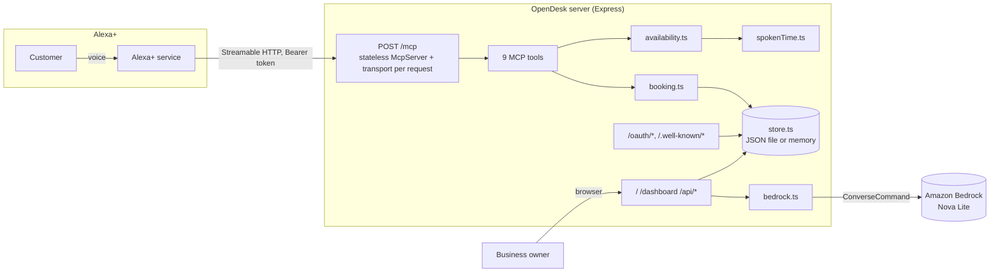

# OpenDesk

OpenDesk gives small local businesses (barbers, clinics, pet groomers) voice
booking on Alexa+, with zero app to build. It's an MCP server: Alexa+ calls it
directly over the Model Context Protocol, and an owner dashboard lets a
business see their book, run a Bedrock-powered daily briefing, and onboard
their catalog in minutes.

Built for the Alexa+ track of the Amazon Developer Hackathon, plus the AWS
Builder mini challenge (Amazon Bedrock) and the Open Source mini challenge
(see [extras/spoken-window](extras/spoken-window)).

## Demo

[▶ Watch the demo video](docs/demo.mp4)

## Why this, and why now

Small shops run on a phone line and a paper book. Alexa+ can now call tools
directly mid-conversation, so a customer can just ask their Echo to book a
haircut, the same way they'd ask a human receptionist. OpenDesk is that
receptionist: it knows the business's real services, staff, hours, and
appointment book, and it never confirms anything without reading it back
first.

## Architecture



Every `/mcp` request is fully stateless: a new `McpServer` and
`StreamableHTTPServerTransport` are created per request
(`sessionIdGenerator: undefined`), matching MCP spec **2025-11-25**. Tool
handlers never make a network or LLM call; all business logic is synchronous
JSON-file-backed state, which is what keeps every round trip under Alexa+'s
500ms budget (p50 is sub-10ms locally).

## MCP tools

| Tool | Type | What it does |
|---|---|---|
| `find_businesses` | read-only | Keyword/category search over the directory |
| `get_business_details` | read-only | Services, prices, staff, hours, policy |
| `find_availability` | read-only | Open slots for a service; natural-language `when`, closed/fully-booked messaging, 7-day alternatives |
| `hold_appointment` | write | 5-minute hold on a slot, read back for confirmation |
| `confirm_appointment` | write, idempotent | Turns a hold into a booking, spells the code aloud |
| `list_my_appointments` | read-only | The caller's own bookings, including waitlist offers |
| `reschedule_appointment` | write | Atomic move; frees the old slot to the waitlist |
| `cancel_appointment` | write, idempotent, destructive | Late-fee warning, auto-offers the freed slot to the waitlist |
| `join_waitlist` | write, idempotent | Joins a waitlist for a service/time window |

## Voice-design choices

- **Never confirm without an explicit yes.** `hold_appointment` always reads
  back what it's about to book ("I'm holding a Men's Cut with Sam... for
  $35. Should I book it?") and the server instructions tell the model to wait
  for a yes before calling `confirm_appointment`. A hold expires in 5 minutes
  if nobody confirms it.
- **Spoken time, not ISO 8601.** `find_availability` accepts phrases like
  *"thursday after work"*, *"tomorrow morning"*, or *"asap"* and resolves them
  with [spoken-window](extras/spoken-window) rather than asking the customer
  to speak a date format.
- **Codes are built to be heard, not read.** Appointment codes use a
  4-character alphabet with no `0/O/1/I/L`, and are always read back spelled
  out with spaces ("C N Q E"), because "see-en-cue-ee" said quickly is exactly
  the kind of thing that gets mistyped later.
- **Closed vs. fully booked are different sentences.** A business that's
  closed says so plainly; a business that's just fully booked offers the
  waitlist and the next open time, because those call for different
  customer responses.
- **Errors always say what to do next.** Every tool error is a sentence a
  voice assistant can act on ("Use find_businesses to look it up"), not a
  stack trace.

## Run locally

```sh
npm install
cp .env.example .env     # defaults already work for a local demo
npm run dev              # tsx src/server.ts, AUTH_MODE=none by default
```

Open `http://localhost:3000` for the owner dashboard, or point an MCP client
(e.g. the MCP Inspector, or the `alexa-ai` CLI below) at
`http://localhost:3000/mcp`. With `AUTH_MODE=none` (the default), every call
is attributed to a fixed demo customer, "Alex Rivera", so you can drive the
whole flow with no account-linking step.

To freeze the clock for a deterministic demo:

```sh
FRONTDESK_NOW=2026-10-18T09:00:00-07:00 npm run dev
```

Run the test suite (unit tests + a real end-to-end run that spawns the server
as a child process):

```sh
npm test
```

## Connect to Alexa+

1. Deploy the server somewhere with a public HTTPS URL (see App Runner below,
   or use `cloudflared` for a quick tunnel while developing locally).
2. Set `PUBLIC_URL` to that HTTPS URL and, for anything beyond local testing,
   set `AUTH_MODE=oauth` plus the `OAUTH_*` variables below (Alexa+ requires
   account linking for any addon that reads/writes user-specific data).
3. Fill in `addon-package/addon.json`'s `REPLACE-ME` fields (icons, carousel
   images, privacy/terms URLs, and the MCP endpoint URL) and submit it through
   the Alexa+ developer console's MCP Toolkit flow.
4. Alexa+ will discover auth via `/.well-known/oauth-protected-resource` and
   `/.well-known/oauth-authorization-server`, which OpenDesk serves itself,
   no third-party auth provider needed.

For local development without a real Alexa+ submission, `cloudflared` gives
you a throwaway public HTTPS URL in seconds:

```sh
cloudflared tunnel --url http://localhost:3000
```

Then connect with the `alexa-ai` CLI (or any MCP-compatible client) against
`https://<the-cloudflared-url>/mcp`.

## Deploy to AWS App Runner

```sh
docker build -t opendesk .
docker run --rm -p 3000:3000 --env-file .env opendesk   # smoke test locally
```

Push the image to Amazon ECR, then create an App Runner service from it:

```sh
aws ecr create-repository --repository-name opendesk
docker tag opendesk:latest <account-id>.dkr.ecr.<region>.amazonaws.com/opendesk:latest
aws ecr get-login-password --region <region> | docker login --username AWS --password-stdin <account-id>.dkr.ecr.<region>.amazonaws.com
docker push <account-id>.dkr.ecr.<region>.amazonaws.com/opendesk:latest

aws apprunner create-service \
  --service-name opendesk \
  --source-configuration '{
    "ImageRepository": {
      "ImageIdentifier": "<account-id>.dkr.ecr.<region>.amazonaws.com/opendesk:latest",
      "ImageRepositoryType": "ECR",
      "ImageConfiguration": { "Port": "3000" }
    },
    "AutoDeploymentsEnabled": true
  }'
```

Set `PUBLIC_URL` to the App Runner service URL, `DATA_FILE` to a writable path
(App Runner's filesystem is ephemeral across deploys, so for anything beyond a
demo, mount persistent storage or swap `store.ts` for a real database), and
grant the service's IAM role `bedrock:InvokeModel`/`bedrock:Converse` on the
model you configure in `BEDROCK_MODEL_ID`.

## Configuration

| Variable | Default | Purpose |
|---|---|---|
| `PORT` | `3000` | HTTP port |
| `PUBLIC_URL` | `http://localhost:<PORT>` | Public base URL; used in OAuth metadata and the MCP endpoint `resource` |
| `AUTH_MODE` | `none` | `none` for a fixed demo customer, `oauth` for real Alexa+ account linking |
| `OAUTH_CLIENT_ID` | - | Pre-registered client id (Alexa+ doesn't support dynamic client registration) |
| `OAUTH_CLIENT_SECRET` | - | Optional; enables `client_secret_post`/`client_secret_basic` at the token endpoint |
| `OAUTH_REDIRECT_URIS` | - | Comma-separated allow-list of redirect URIs |
| `OAUTH_ALLOW_ANY_REDIRECT` | `false` | Dev only: skip the redirect_uri allow-list |
| `DATA_FILE` | `data/store.json` | Where state is persisted; `:memory:` for in-memory only |
| `DASHBOARD_TOKEN` | - | Optional bearer token (`?token=` or `x-dashboard-token`) protecting `/api/*` |
| `AWS_REGION` | `us-east-1` | Region for the Bedrock client |
| `BEDROCK_MODEL_ID` | `us.amazon.nova-lite-v1:0` | Model used for onboarding and the daily briefing |
| `FRONTDESK_NOW` | - | Freezes the clock (ISO 8601 with offset); for demos and tests only |

## Repo layout

```
src/            server, MCP tools, booking/availability engine, OAuth, Bedrock
public/         owner dashboard (static, no build step)
test/           unit tests + e2e (spawns the real server)
extras/spoken-window/   the spoken-time engine as a standalone MIT package
addon-package/  Alexa+ MCP Toolkit addon manifest
```

## License

MIT, see [LICENSE](LICENSE).
